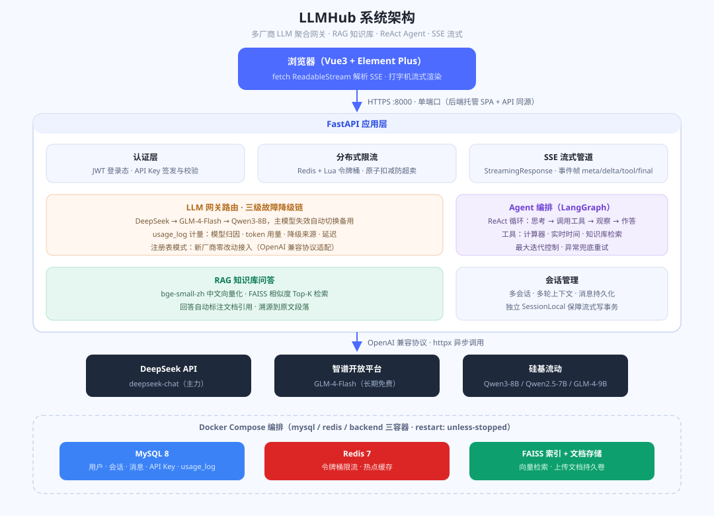

# LLMHub

轻量级大模型应用开发平台（个人项目，求职作品）



## 核心特性

- **多厂商聚合网关**：注册表 + OpenAI 协议适配层统一接入 DeepSeek / 智谱 / 硅基流动（3 厂商 5 模型），新厂商零改动接入
- **三级故障降级链**：主模型失效自动切换备用模型，故障注入演练验证，`usage_log` 精准归因
- **分布式限流**：Redis + Lua 令牌桶，API Key 级配额原子扣减
- **调用计量**：token 用量 / 降级来源 / 延迟全量落库，支撑成本核算与模型选型
- **RAG 知识库问答**：bge-small-zh 向量化 + FAISS 检索，回答自动标注引用溯源
- **ReAct Agent**：LangGraph 编排多轮工具调用（计算器 / 时间 / 知识库检索），迭代控制 + 异常兜底
- **SSE 全链路流式**：FastAPI StreamingResponse ↔ 前端 fetch ReadableStream，打字机渲染
- **一体化部署**：Docker Compose 三容器编排，后端托管 SPA，单端口免 CORS

## 技术栈

FastAPI · SQLAlchemy · MySQL 8 · Redis 7 · LangGraph · FAISS · bge-small-zh · Vue3 · Docker Compose

## 快速启动

```bash
# 1. 准备环境变量
cp .env.example .env      # 填入你自己的 LLM API Key

# 2. 构建前端（只需在 frontend 代码变更后重新执行）
cd frontend && npm install && npm run build && cd ..

# 3. 一键启动（mysql + redis + backend，前端产物由后端直接托管）
docker compose up -d --build

# 4. 验证
curl http://localhost:8000/health
```

**演示/答辩场景**：打开 Docker Desktop → 打开浏览器访问 <http://localhost:8000> 即完整应用
（三容器 `restart: unless-stopped`，Docker Desktop 启动后自动拉起，无需任何命令）。

开发模式（可选）：`cd frontend && npm run dev`，访问 <http://localhost:5173>，改代码热更新。

接口文档：<http://localhost:8000/docs>

## 项目结构

```
llmhub/
├── docker-compose.yml     # mysql / redis / backend 三容器编排
├── backend/
│   ├── Dockerfile
│   └── app/
│       ├── main.py        # FastAPI 入口（含前端 SPA 托管与 fallback）
│       ├── config.py      # 环境变量配置
│       ├── database.py    # SQLAlchemy 引擎与会话
│       ├── models.py      # ORM 模型
│       ├── security.py    # JWT + bcrypt
│       └── api/auth.py    # 注册登录
├── frontend/              # Vue3（vite build 产物由 backend 托管，单端口部署）
└── dist → 由 `npm run build` 生成，compose 只读挂载进 backend 容器
```

## 开发路线

见《LLMHub_AI应用平台实施方案.md》：网关 → RAG → Agent → MCP → 前端 → 部署。
